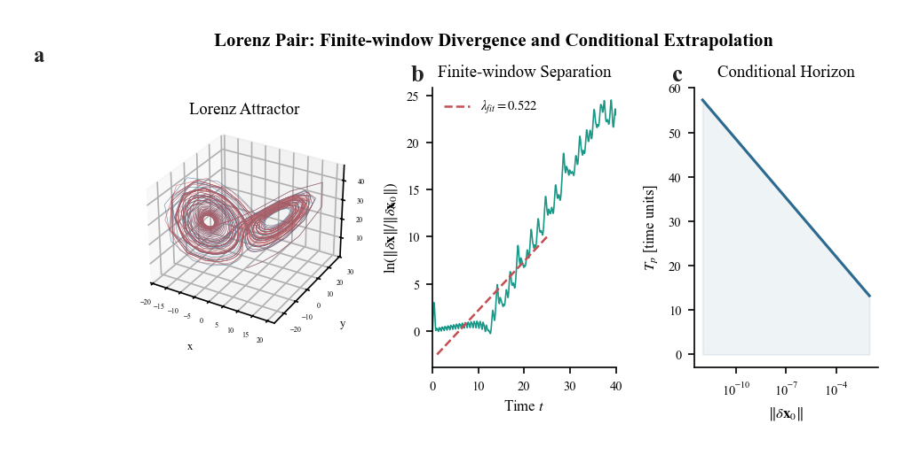
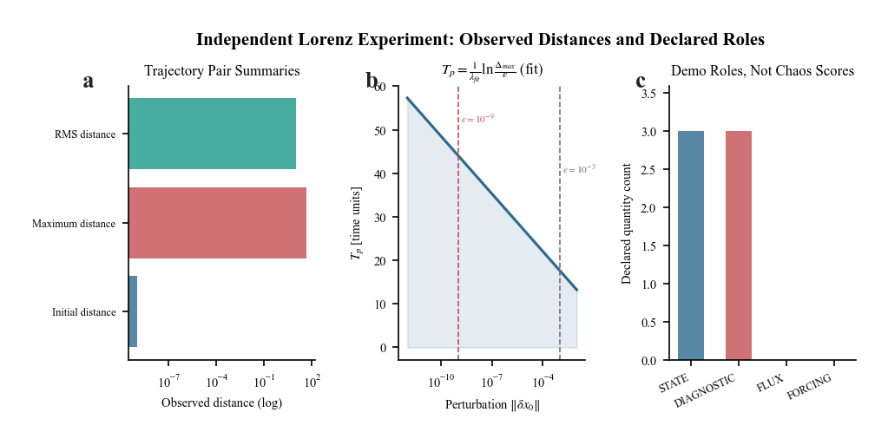

# 教程 14 -- Lyapunov 指数与可预测性视界

## 1. 概述

本独立 Lorenz-63 示例估计两条邻近轨迹的有限时间发散，说明轨迹检查之外还需要已声明结构不变量和物理预算。它不替代轨迹、统计或观测验证，也不测试 RELIC 模拟。

### 先决条件

- [教程 13](./13_differentiability.md)：可微性与基于梯度的标定

---

## 2. 数学基础

### 2.1 最大 Lyapunov 指数

$$
\lambda_{\max} = \sup_{v\ne0}\limsup_{t \to \infty} \frac{1}{t} \ln \frac{\|D\Phi_t(x_0)v\|}{\|v\|} \tag{1}
$$

这里 $D\Phi_t(x_0)v$ 是线性化切向扰动。脚本不积分切向系统或反复归一化扰动，只拟合固定有限扰动的双轨迹距离；发散饱和后的距离不能用于渐近指数估计。

### 2.2 可预测性视界（coertheory.md，第 1.2 节）

$$
T_p \approx \frac{1}{\hat{\lambda}_{\max}} \ln \frac{\Delta_{\max}}{\|\delta \mathbf{x}_0\|} \tag{2}
$$

超过 $T_p$ 后，轨迹发散超出有用精度（$\Delta_{\max}$）。

### 2.3 RELIC 启示

- **结构不变量和预算**：在已声明拓扑、单位、范围和物理假设成立时仍可检查；混沌本身不证明这些前提。
- **轨迹匹配**：仅当 $t < T_p$ 时有效

> **参考文献**：Lorenz (1963)；coertheory.md，第 1.2 节

---

## 3. 计算细节

- **系统**：Lorenz-63（$\sigma=10, \rho=28, \beta=8/3$）
- **积分**：RK4，$\Delta t = 0.01$，$N = 5000$ 步
- **扰动**：$\epsilon = 10^{-9}$，施加于 $x_0$
- **结果（有限时间拟合）**：$\lambda_{\max} \approx 0.522$（文献值：$\sim 0.905$；估计值取决于拟合窗口和扰动方向）
- **拟合窗口（实现细节）**：$\hat{\lambda}_{\max}$ 通过对 $t\in(1,25)$ 区间内 $\ln(\|\delta\mathbf{x}\|/\|\delta\mathbf{x}_0\|)$ 的线性回归获得

---

## 4. RELIC 实现映射

| 概念             | RELIC                 | 实现方式                   |
| ---------------- | --------------------- | -------------------------- |
| $\lambda_{\max}$ | DIAGNOSTIC 变量       | 后处理计算                 |
| 状态轨迹         | STATE 变量            | `torch.Tensor`，受混沌影响 |
| 结构测试         | $\sigma(\mathcal{G})$ | 独立于轨迹                 |

---

## 5. 图表与输出

### 5.1 图 1：数学 Lorenz 分析（`14_math_lyapunov.png`）



**图 (a)：3D Lorenz 吸引子** -- 两条初始条件几乎相同的轨迹（蓝色、橙色）在约 20 个时间单位后明显发散，形成特征性的蝴蝶图案。

**图 (b)：Lyapunov 发散** -- $\ln(\|\delta\mathbf{x}\|/\|\delta\mathbf{x}_0\|)$ 随时间的变化。线性拟合给出 $\lambda_{\max}$。斜率确认了混沌区域中的指数发散。

**图 (c)：可预测性视界** -- $T_p$ 随扰动大小 $\|\delta\mathbf{x}_0\|$ 的变化，呈对数依赖关系。较小的初始扰动延长可预测性，但仅为对数级别。

### 5.2 图 2：RELIC 验证策略（`14_relic_lyapunov.png`）



**图 (a)：轨迹对摘要** -- 对数条形图显示两条实际计算的 Lorenz 轨迹之间初始、最大和均方根距离。

**图 (b)：可预测性视界** -- 详细的 $T_p(\epsilon)$ 曲线，标注了扰动水平（$10^{-9}$ 和 $10^{-3}$ 是选定示例扰动，不是机器精度或实测 RELIC 不确定性）。

**图 (c)：示例角色，不是混沌评分** -- 计数为三个状态坐标和三个已声明派生量（距离、拟合斜率、条件视界），本独立示例没有 FLUX 或 FORCING 量。这是角色计数，不是 Lyapunov 测量。

注：`VariableKind.PARAMETER` 存在于 RELIC 的 SSOT 中，但不在此教程图中绘制，因为 Lorenz-63 演示将参数视为固定常数而非演化状态变量。

---

## 6-9. 比较、控制台输出、关联与参考文献

| 指标             | 预期（文献） | 观测（本教程） | 匹配 |
| ---------------- | ------------ | -------------- | ---- |
| $\lambda_{\max}$ | $\sim 0.9$（渐近参考） | 0.522（有限窗口拟合） | 估计对象不同，不是数值一致 |

**控制台**：

```text
[INFO] finite-window log-separation slope = 0.522
  Reference ~0.9 is asymptotic; this fit is not a numerical PASS against it
  T_p for eps=1e-9: 44.1 time units
```

**关联**：教程 01（结构不变量） | **参考文献**：Lorenz (1963)；Strogatz (2015)；coertheory.md 第 1.2 节
