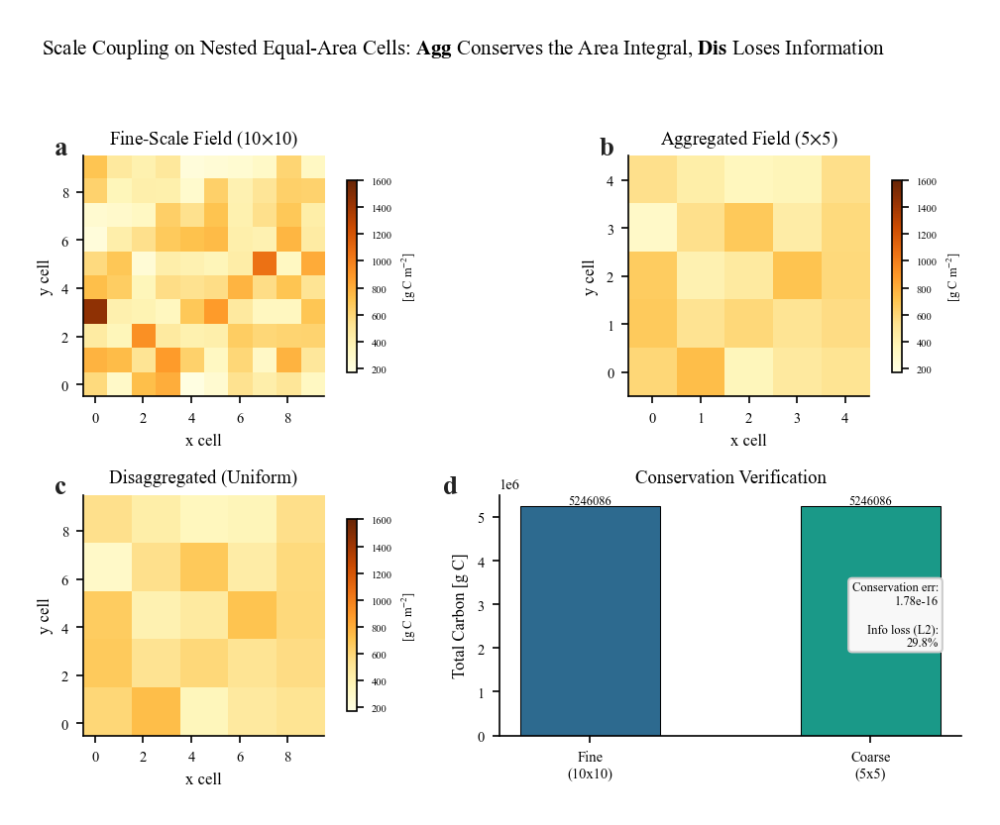

# 教程 15 -- 尺度耦合：聚合、广播与信息损失

## 1. 概述

本教程演示嵌套网格上的聚合（面积加权平均）与广播解聚合。在面积加权内积下，广播是面积加权平均的伴随（$R=M_c^{-1}P^TM_f$）。在嵌套且完全覆盖的网格上聚合保持面积积分，而解聚合无法恢复子格变异。脚本是独立的 NumPy 演示，只从 RELIC 导入 `SpatialScale` 枚举。

### 先决条件

- [教程 04](./04_semantic_ssot.md)：`SpatialScale` 枚举

---

## 2. 数学基础

### 2.1 聚合（升尺度）

**强度量**：$\phi_{\text{coarse}} = \sum_i w_i \phi_i / \sum_i w_i$（面积加权平均）

**广延量**：对面密度 $\phi_i$ [kg m$^{-2}$] 在嵌套网格上，$\Phi_{\text{coarse}} = \sum_i \phi_i A_i$（守恒求和）。`ConservativeRemap` 需要每格总量 $X_i=\phi_iA_i$，不能直接输入面密度；`HierarchicalAggregator` 需要面密度。第 3 节数值来自 NumPy 在嵌套等面积网格上的分块平均，守恒由构造保证，不是对 RELIC 算子的检验。

### 2.2 解聚合（降尺度）

$$\phi_{\text{fine},i} = \phi_{\text{coarse},J(i)} \quad \text{（均匀分配）}$$

### 2.3 加权伴随与信息损失

取 $M_f=\mathrm{diag}(A_i)$、$M_c=\mathrm{diag}(A_J)$，有 $\langle Pc,f\rangle_{M_f}=\langle c,Rf\rangle_{M_c}$ 且 $RP=I$，但 $PR\neq I$：除非 $\phi_f$ 在每个粗格内为常数，否则 $\|\phi_f-P(R\phi_f)\|>0$（$P$ 为广播 Dis，$R$ 为面积加权平均 Agg）。

> **参考文献**：spatiotemporal_scale_topology.md，第 1.1、2.1-2.3 节；Jones (1999)

---

## 3. 计算细节

- 细网格：$10 \times 10$，对数正态分布的土壤碳 $C_{\text{soil}} \sim \text{LogN}(\mu=\ln 500, \sigma=0.5)$
- 粗网格：$5 \times 5$（面积加权平均）
- 守恒误差（相对值，$|\Sigma_{\text{fine}}-\Sigma_{\text{coarse}}|/\Sigma_{\text{fine}}$）：$1.78\times 10^{-16}$（$0.0000\%$）
- 信息损失（相对 L2）：$0.2975$（$29.75\%$）

---

## 4-5. RELIC 映射与图表

### 图：尺度耦合（`15_scale_coupling.png`）

**图 (a)：细尺度场（10x10）** -- 具有对数正态分布的异质性土壤碳。颜色深浅表示空间变异性。

**图 (b)：聚合场（5x5）** -- 空间平滑后的版本；块内变异性丢失。

**图 (c)：解聚合场（均匀）** -- 每个细网格单元获得其粗网格均值——可见块状均匀模式。

**图 (d)：守恒验证** -- 条形图显示细网格与粗网格总碳一致。文本框报告守恒误差（$1.78\times 10^{-16}$，相对 $0.0000\%$）和信息损失百分比（$29.75\%$）。

---

## 6-9. 比较、控制台输出、关联与参考文献

| 指标     | 预期     | 观测                  | 匹配 |
| -------- | -------- | --------------------- | ---- |
| 守恒误差 | $\sim 0$ | $1.78\times 10^{-16}$ | PASS |
| 信息损失 | $> 0$    | $29.75\%$             | PASS |

**控制台**：`[OK] Upscaling: 10x10 -> 5x5` ... `Conservation error: 1.78e-16 (0.0000%)` | **关联**：教程 17（纤维丛），教程 18（自然变换） | **参考文献**：Jones (1999)；Wood et al. (2004)；spatiotemporal_scale_topology.md
