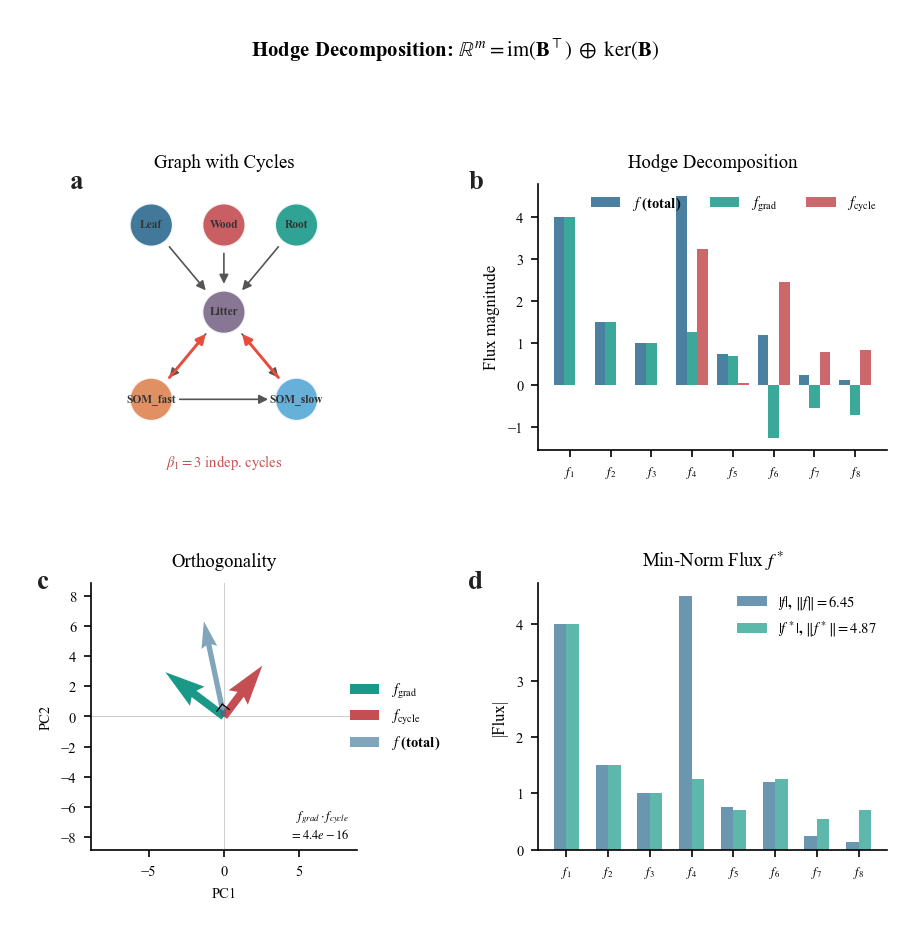
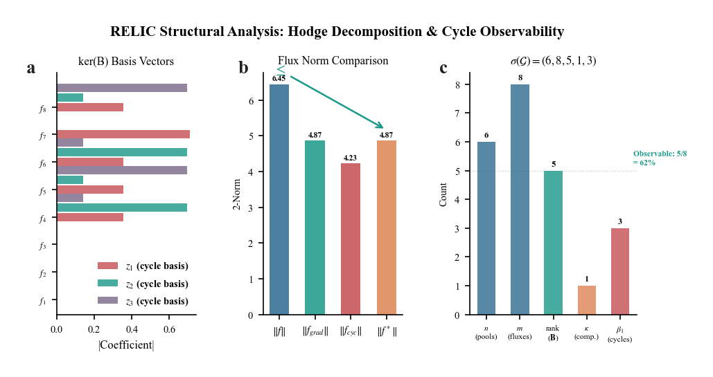

# 教程 16 -- 生物地球化学图上的 Hodge 分解

## 1. 概述

本独立 NumPy/SciPy 教程演示带符号边向量在欧氏内积下分解为关联矩阵梯度分量及关联矩阵核分量。它不调用 RELIC typed DEC/Hodge 算子，不施加物理非负转移约束，也不认证能量或熵闭合。

### 先决条件

- [教程 01](./01_incidence_matrix_conservation.md)：关联矩阵
- [教程 02](./02_topological_fingerprint.md)：Betti 数与循环秩

---

## 2. 数学基础

### 2.1 Hodge 分解（coertheory.md，第 2.4 节 / 定理 3.3）

$$
\mathbb{R}^m = \text{im}(\mathbf{B}^\top) \oplus \ker(\mathbf{B}) \tag{1}
$$

$$
f = f_{\text{grad}} + f_{\text{cyc}} \tag{2}
$$

其中 $f_{\text{grad}} = \mathbf{B}^\top (\mathbf{B} \mathbf{B}^\top)^+ \mathbf{B} f$，$f_{\text{cyc}} = (I - P_{\text{im}(\mathbf{B}^\top)}) f$。

此处使用单位权重的欧氏内积；非平凡 Hodge 权重会改变伴随与正交投影。线性可行性允许带符号 $f$；若要求 $f\ge0$ 或施加速率界限，还需要额外约束。循环空间表示不可由节点变化率区分的有符号循环，不必是可实现的定向生化反馈。

### 2.2 关键性质

- **正交性**：$\langle f_{\text{grad}}, f_{\text{cyc}} \rangle = 0$
- **唯一性**：分解是唯一的
- 循环空间维度：$\beta_1 = m - n + \kappa$
- **可行性（闭合系统）**：节点趋势 $g\in\mathbb{R}^n$ 可由内部交换实现，当且仅当 $\exists f\in\mathbb{R}^m$ 使得 $g=\mathbf{B}f$
- **最小范数通量**：在所有满足 $\mathbf{B}f=g$ 的 $f$ 中，唯一最小 2-范数解为 $f^*=\mathbf{B}^\top (\mathbf{B}\mathbf{B}^\top)^+ g$

> **参考文献**：coertheory.md，第 2.4 节（定理 3.3）及推论 2.5.1-2.5.3

---

## 3. 计算细节

- 图：6 个储库，8 个通量（含 $\beta_1=3$ 个独立循环）
- 关联矩阵 $\mathbf{B} \in \mathbb{R}^{6 \times 8}$
- 约定：若边 $j$ 进入节点 $i$，则 $\mathbf{B}_{i,j}=+1$；若离开则为 $-1$
- 拓扑指纹（来自教程 02）：$\sigma(\mathcal{G})=(n,m,\mathrm{rank}(\mathbf{B}),\kappa,\beta_1)=(6,8,5,1,3)$
- 使用 `np.linalg.pinv` 计算 Moore-Penrose 伪逆
- 使用 `scipy.linalg.null_space` 计算 $\ker(\mathbf{B})$

---

## 4-5. RELIC 映射与图表

### 图 1：数学 Hodge 分解（`16_math_hodge.png`）

**图 (a)：过程图** -- 6 个储库、8 个通量的有向图。高亮显示循环边；标注 $\beta_1=3$ 个独立循环。

**图 (b)：通量分解** -- 分组条形图，显示各边的原始 $f$、梯度 $f_{\text{grad}}$ 和循环 $f_{\text{cyc}}$。

**图 (c)：正交性** -- 可视化投影，显示 $f_{\text{grad}} \perp f_{\text{cyc}}$，内积 $\approx 10^{-15}$。

**图 (d)：最小范数通量** -- 对比 $f^*$（最小范数通量）与原始通量的条形图；显示范数缩减量。

### 图 2：RELIC 结构分析（`16_relic_hodge.png`）

**图 (a)：$\ker(\mathbf{B})$ 基向量** -- 水平条形图显示循环空间基的绝对系数（$Z_1,Z_2,Z_3$）。基向量数等于 $\beta_1$。

**图 (b)：通量范数对比** -- 对比 $\|f\|$、$\|f_{\text{grad}}\|$、$\|f_{\text{cyc}}\|$ 和 $\|f^*\|$ 的条形图。

**图 (c)：指纹与可观测性** -- $(n,m,\mathrm{rank},\kappa,\beta_1)$ 的条形图，标注可观测比例 $\mathrm{rank}(\mathbf{B})/m$。

---

## 6-9. 比较、控制台输出、关联与参考文献

| 指标                              | 预期        | 观测         | 匹配 |
| --------------------------------- | ----------- | ------------ | ---- |
| 正交性 $\langle f_g, f_c \rangle$ | $\approx 0$ | $< 10^{-14}$ | PASS |
| $\beta_1 = m - n + \kappa$        | 3           | 3            | PASS |

**控制台**：`[OK] Hodge decomposition: f_grad . f_cycle = 4.44e-16` | **关联**：教程 02（$\beta_1$），教程 01（关联矩阵） | **参考文献**：coertheory.md，第 2.4 节及推论 2.5.1-2.5.3
