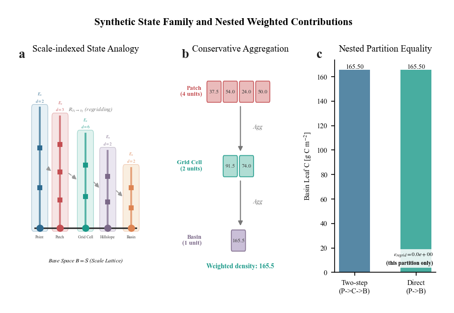
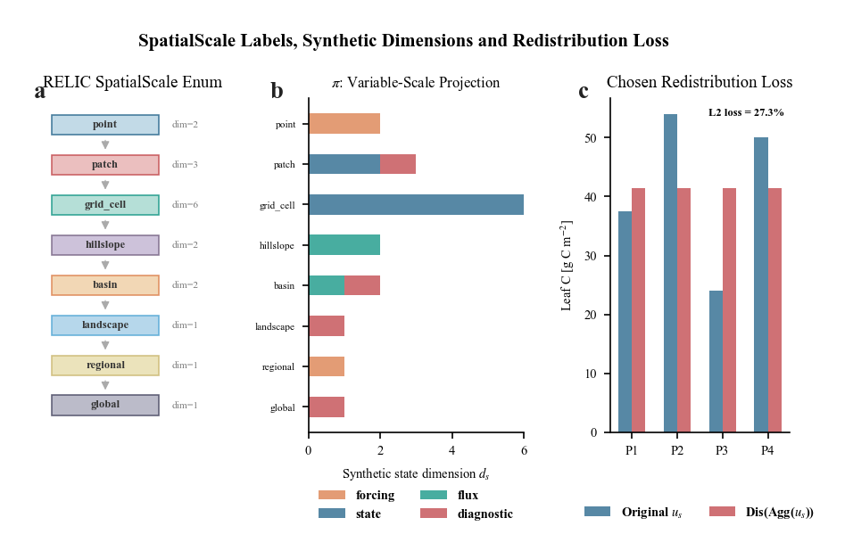

# 教程 17 -- 多尺度状态空间的纤维丛结构

## 1. 概述

本独立 NumPy 教程以按尺度索引的状态空间族作纤维丛类比。SpatialScale 标签和合成维度不证明局部平凡性、光滑纤维丛或几何联络。数值示例仅检查嵌套聚合及其信息损失。

### 先决条件

- [教程 15](./15_scale_coupling.md)：升尺度/降尺度基础

---

## 2. 数学基础

### 2.1 纤维丛（spatiotemporal_scale_topology.md，定义 2.2）

$$
\pi: E \to B, \quad B = \mathcal{S}, \quad E_s = \prod_{v \in V_s} \mathbb{R}^{d_v} \tag{1}
$$

### 2.2 联络（定义 2.3）

令 $R_{s_1 \to s_2}:E_{s_1}\to E_{s_2}$ 表示已声明聚合映射。本例因分区嵌套且各映射采用一致的广延量求和，满足 $R_{s_2\to s_3}\circ R_{s_1\to s_2}=R_{s_1\to s_3}$。一般守恒重网格不必可传递或可逆，也不由此成为几何平行移动。

### 2.3 重建误差（信息损失）

$\|u_s-\text{Dis}(\text{Agg}(u_s))\|$ 衡量重建误差：在本例非均匀场上为正，在可重建子空间上为零。它不是微分几何曲率。

> **参考文献**：Husemoller (1993)；Jones (1999)；spatiotemporal_scale_topology.md，第 2.3-2.4 节

---

## 3-5. 计算、RELIC 映射与图表

### 图 1：数学纤维丛 (`17_math_fiber.png`)

**图 (a)：纤维丛示意图** -- 尺度晶格基空间上的垂直纤维。每个纤维的高度表示状态向量的维度。虚线箭头显示尺度间的平行移动（重网格化）。

**图 (b)：守恒聚合** -- 流程图：4 个斑块 $\to$ 2 个网格单元 $\to$ 1 个流域，每个层级的总 C 守恒。

**图 (c)：传递性检查** -- 条形图比较两步聚合与直接聚合。传递性误差 $= 0.00\mathrm{e}{+00}$（在此构造示例中对广延量精确）。

### 图 2：RELIC SpatialScale 集成 (`17_relic_fiber.png`)

**图 (a)：RELIC SpatialScale 枚举** -- 从 POINT 到 GLOBAL 的尺度标签及合成示例维度；它们不是运行时状态大小。

**图 (b)：变量-尺度投影** -- 堆叠条形图显示每个尺度上各 VariableKind（FORCING/STATE/FLUX/DIAGNOSTIC）的纤维维度。

**图 (c)：重建误差（信息损失）** -- 分组条形图：斑块层级的原始值 vs Dis(Agg(原始值))。

---

## 6-9. 对比、控制台输出、关联与参考文献

**控制台（本轮）**：嵌套加权和 165.5000；本分区等式误差 0.00e+00；重分配 L2 损失 23.4667，相对损失 27.28%。这些结果限于所选合成分区与重分配规则。
