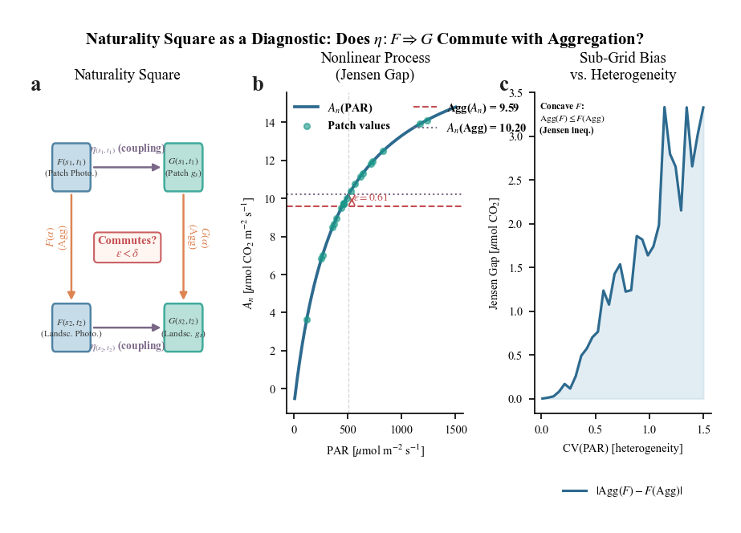
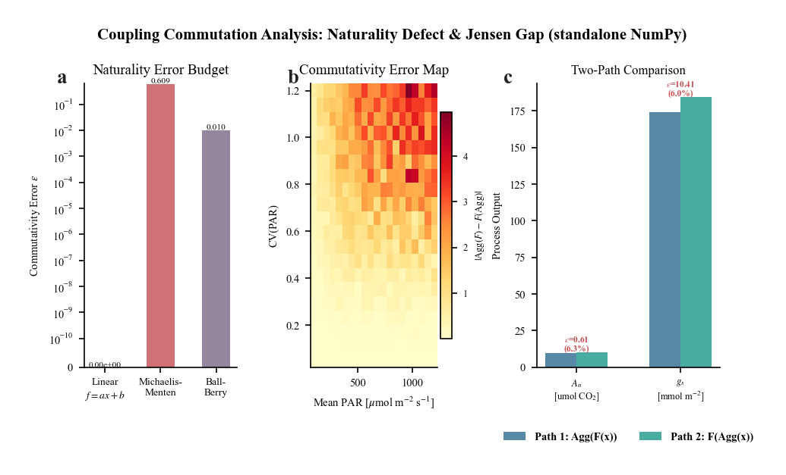

# 教程 18 -- 自然变换：把自然性方图用作耦合诊断

## 1. 概述

本教程把**自然变换** $\eta: F \Rightarrow G$（spatiotemporal_scale_topology.md，定义 3.3）的自然性方图用作诊断：衡量过程与空间聚合是否可交换。RELIC 的耦合一般不是自然变换。仿射过程在归一化权重下方图可交换；对非线性过程（Michaelis-Menten 光合作用），交换缺陷即 **Jensen 间隙**（聚合偏差）。RELIC 运行时不检查该性质；脚本是独立的 NumPy 演示，只导入 RELIC 元数据枚举。

### 先决条件

- [教程 15](./15_scale_coupling.md)：聚合算子
- [教程 17](./17_fiber_bundles.md)：纤维丛结构

---

## 2. 数学基础

### 2.1 自然性方图

$$
\begin{array}{ccc}
F(s_1,t_1) & \xrightarrow{\eta_{(s_1,t_1)}} & G(s_1,t_1) \\
\downarrow F(\alpha) & & \downarrow G(\alpha) \\
F(s_2,t_2) & \xrightarrow{\eta_{(s_2,t_2)}} & G(s_2,t_2)
\end{array}
\tag{1}
$$

若某耦合是自然变换，则对每个尺度转换 $\alpha:(s_1,t_1)\to(s_2,t_2)$ 方图都应交换：

$$
G(\alpha)\circ \eta_{(s_1,t_1)} = \eta_{(s_2,t_2)}\circ F(\alpha). \tag{2}
$$

在本教程中，我们将 $\alpha$ 特化为空间聚合态射（PATCH $\to$ landscape）。交换性测试变为双路径比较：

$$
\mathrm{Agg}(F(x)) \stackrel{?}{=} F(\mathrm{Agg}(x)). \tag{3}
$$

### 2.2 Jensen 间隙

对于凹函数 $F$，Jensen 不等式给出 $\mathbb{E}[F(X)]\le F(\mathbb{E}[X])$。间隙 $\epsilon=|F(\text{Agg}(x))-\text{Agg}(F(x))|$ 量化已声明分布与聚合权重下的子网格偏差；CV 本身不决定间隙大小，图中趋势限于所采样的 Gamma 分布族。

> **参考文献**：Mac Lane (1971)；Jensen (1906)；spatiotemporal_scale_topology.md，第 3.4 节

---

## 3. 计算细节

- $F$：Michaelis-Menten 光合作用 $A_n = A_{\max} \cdot \text{PAR} / (\text{PAR} + K_{\text{PAR}}) - R_d$（凹函数）
- $G$：Ball-Berry 气孔导度 $g_s = g_0 + g_1 A_n RH / C_s$（关于 $A_n$ 线性）
- 20 个斑块，具有异质性 PAR（$\text{Gamma}(3, 200)$）
- 线性过程：$f(x) = ax + b$ -- 精确交换（$\epsilon \approx 10^{-14}$）

---

## 4-5. RELIC 映射与图表

### 图 1：数学自然性 (`18_math_natural.png`)

**图 (a)：自然性方图** -- 四个节点（斑块光合、斑块 $g_s$、景观光合、景观 $g_s$），水平耦合箭头（$\eta$）和垂直聚合箭头（$\alpha$）。中央框标注"交换？"

**图 (b)：非线性过程（Jensen 间隙）** -- 蓝色曲线：$A_n(\text{PAR})$；散点：斑块值；水平线比较 $\text{Agg}(A_n)$ vs $A_n(\text{Agg})$；双箭头显示 $\epsilon$。

**图 (c)：Jensen 间隙 vs 异质性** -- $\epsilon$ 随 CV(PAR) 增大，确认子网格偏差随空间异质性加剧。

### 图 2：耦合交换性分析 (`18_relic_natural.png`)

**图 (a)：自然性误差预算** -- 条形图（观测值）：线性（$0.00e+00$）、Michaelis-Menten（$0.6085$）、Ball-Berry（$0.0104$）。

**图 (b)：交换性误差图** -- 在平均 PAR $\times$ CV(PAR) 空间上的 $\epsilon$ 热力图。

**图 (c)：双路径比较** -- 分组条形图比较路径 1（Agg(F)）vs 路径 2（F(Agg)）的 $A_n$ 和 $g_s$。

---

## 6-9. 对比、控制台输出、关联与参考文献

| 指标                  | 预期                                        | 观测                | 匹配 |
| --------------------- | ------------------------------------------- | ------------------- | ---- |
| 线性 $\epsilon$       | $\approx 0$                                 | $0.00e+00$          | PASS |
| 光合 $\epsilon_A$     | $>0$（凹函数 Jensen 间隙）                  | $0.6085$            | PASS |
| 气孔 $\epsilon_{g_s}$ | 小但非零                                    | $0.0104$            | PASS |
| Jensen 方向           | $\text{Agg}(F) \le F(\text{Agg})$（凹函数） | $9.5903\le 10.1988$ | PASS |

**参考文献**：Mac Lane (1971)；Jensen (1906)；Farquhar et al. (1980)；Ball et al. (1987)
