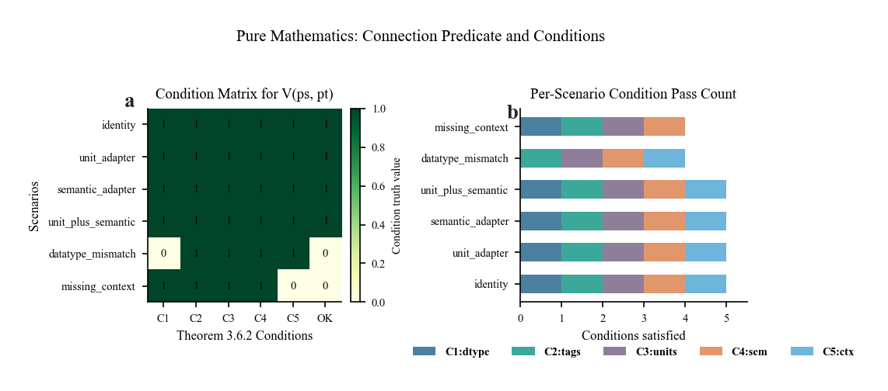
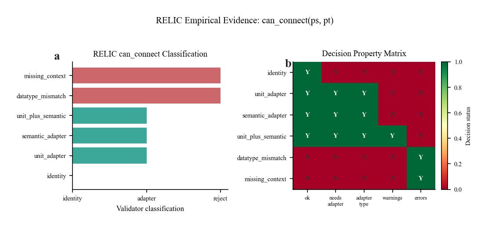

# 教程 19 -- 连接验证器与适配器需求

## 1. 概述

本教程演示了**定理 3.6.2**（coertheory.md）：连接验证判定 $\mathcal{V}(p_s, p_t;\ \mathsf{strict}) = (\mathsf{ok}, A, W)$，它在允许两个端口连接之前检查数据类型兼容性（C1）、可选标签匹配（C2）、单位闭合（C3）、语义兼容性（C4）和上下文需求（C5）。

### 先决条件

- [教程 04](./04_semantic_ssot.md)：语义 SSOT 和类型系统

---

## 2. 数学基础

### 2.1 连接判定（定理 3.6.2）

端口规格：$p = (\tau, \mathsf{u}, T, \mathsf{s}, K)$，其中 $\tau$ = 数据类型，$\mathsf{u}$ = 单位，$T$ = 标签，$\mathsf{s}$ = 语义，$K$ = 上下文。

$$
\mathcal{V}(p_s, p_t;\ \mathsf{strict}) =
\begin{cases}
(\mathsf{ok}=1, A, W) & \text{若 } C_1 \land C_2 \land C_3 \land C_4 \land C_5 \\
(\mathsf{ok}=0, \emptyset, \text{errors}) & \text{否则}
\end{cases}
\tag{1}
$$

| 条件 | 检查                           | 违反示例/适配器需求                                |
| ---- | ------------------------------ | -------------------------------------------------- |
| C1   | $\tau_s = \tau_t$ 或任一未声明 | 标量 $\ne$ 张量                                    |
| C2   | 双方声明时标签匹配             | 物理量不匹配                                       |
| C3   | 单位可转换性                   | 单位不同 $\Rightarrow$ 单位适配器（若可转换）      |
| C4   | 语义兼容性                     | 通量 $\to$ 状态 $\Rightarrow$ 语义适配器（若允许） |
| C5   | 上下文需求满足                 | 缺少 `air_density`                                 |

> **参考文献**：coertheory.md，定理 3.6.2；`relic\orchestration\validator.py`

---

## 3-5. 计算、RELIC 映射与图表

六种场景：identity, unit_adapter, semantic_adapter, unit+semantic, datatype_mismatch, missing_context。

### 图 1：数学条件矩阵 (`19_math_connection_validator.png`)



**图 (a)：条件矩阵** -- 6x6 热力图显示每个场景的 C1-C5 和 OK。绿色 (1) = 通过，黄色 (0) = 失败。

**图 (b)：各场景条件通过数** -- 堆叠水平条形图显示每个场景满足的条件，按条件类型着色。

### 图 2：RELIC 验证器证据 (`19_relic_connection_validator.png`)



**图 (a)：RELIC `can_connect` 分类** -- 水平条形图：每个场景的 identity/adapter/reject。

**图 (b)：决策属性矩阵** -- 每个场景的 ok/needs_adapter/adapter_type/warnings/errors 热力图。

---

## 6-9. 对比、控制台输出、关联与参考文献

**控制台（观测值，strict=True）**：

```text
identity           | theorem_ok=True | validator_ok=True | adapter=None | errors=[]
unit_adapter       | theorem_ok=True | validator_ok=True | adapter=unit_cast | errors=[]
semantic_adapter   | theorem_ok=True | validator_ok=True | adapter=semantic_adapter | errors=[]
unit_plus_semantic | theorem_ok=True | validator_ok=True | adapter=semantic_adapter | errors=[]
datatype_mismatch  | theorem_ok=False | validator_ok=False | adapter=None | errors=['datatype_mismatch']
missing_context    | theorem_ok=False | validator_ok=False | adapter=None | errors=['missing_context_requirements']
```

**关联**：教程 04（SSOT 契约），教程 21（输出重叠） | **参考文献**：coertheory.md 定理 3.6.2；`relic\orchestration\validator.py`
