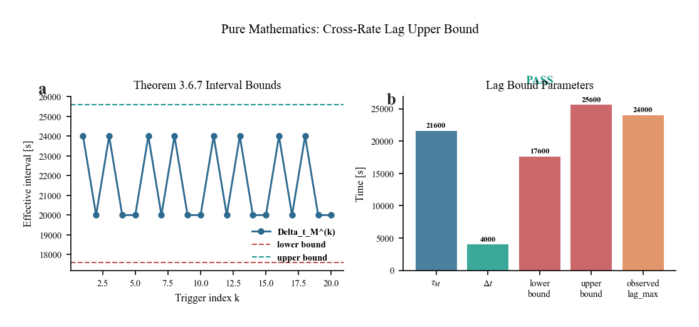
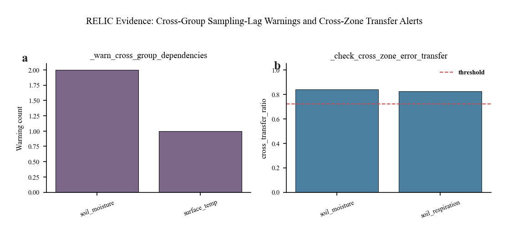

# 教程 20 -- 跨速率滞后边界与跨区域误差转移

## 1. 概述

本教程演示了 **定理 3.6.7** (`coertheory.md`)：多速率执行的跨速率滞后边界。在固定步长 $\Delta t$ 且只有区间索引触发（无事件触发、无 bootstrap/reset 首次执行、$\Delta t$ 不被自适应改变）时，中速率累计间隔满足 $\max(0, \tau_M - \Delta t) \le \Delta t_M^{(k)} \le \tau_M + \Delta t$。medium 函子以该累计长度作为 dt，并以该区间的起点（medium 组的 $t_{\text{last}}$）作为时间参数（`time = t_last`，`dt = t_future - t_last`）。RELIC 的 `_warn_cross_group_dependencies` 在每次 provider 视图发布时运行，对两个方向都告警：较慢消费者读取较快输出（"Cross-group sampling lag"），以及较快消费者读取较慢输出（"Cross-group hold lag"）。`_check_cross_zone_error_transfer` 监控跨区域不平衡。

### 先决条件

- [教程 07](./07_multirate_execution.md)：多速率执行组

---

## 2. 数学基础

### 2.1 滞后边界（定理 3.6.7）

$$
\max(0, \tau_M - \Delta t) \le \Delta t_M^{(k)} \le \tau_M + \Delta t \tag{1}
$$

### 2.2 跨组采样滞后警告

较慢函子读取较快函子生成的变量时，读到的是本步已提交的值，但只在其自身组执行时采样，执行间隔内的快速变化不可见（medium 的采样间隔为 $\tau_M$，slow 为 slow 间隔或日历月）；RELIC 对此方向告警 "Cross-group sampling lag"。fast 函子读取 medium 或 slow 输出时，保持的是生产者上次运行时提交的值，可能落后至多一个 medium/slow 间隔；RELIC 对此方向告警 "Cross-group hold lag"。消费者若在其 `lagged` 依赖中列出该生产者，即确认该读取（只记 DEBUG 日志）；该声明把这条边排除在同步依赖图之外，但并不使消费者读取上一个已接受步的值。`strict_cross_group_dependencies=True` 时，未确认的读取引发 `RuntimeError`，将要发布该计划的注册、退役或恢复被回滚。`resolve_cross_group_deps=True` 时，具有未确认采样滞后的 slow 消费者被移动（而非复制）到 medium 组；已是已调度 slow 成员的函子只在 $t_{\text{last,slow}} = t_{\text{last,medium}}$ 时移动，否则该次发布引发 `RuntimeError`。不会有函子移入 `fast`，也不计算陈旧度上界。

### 2.3 跨区域转移率

$$
r = \frac{\max_{\text{zone}} |\text{contrib}|}{\sum_{\text{zones}} |\text{contrib}|} \tag{2}
$$

如果 $r >$ 阈值，将发出主导区域转移警告。

> **参考文献**：coertheory.md，定理 3.6.7；spatiotemporal_scale_topology.md，第 5.2-5.3 节

---

## 3-5. 计算、RELIC 映射与图表

- $\Delta t = 4000$ s, $\tau_M = 21600$ s，视界 (horizon) = 5 天
- 所有观察到的间隔均在理论边界内：PASS

### 图 1：数学滞后边界 (`20_math_cross_rate_lag.png`)

**图 (a)：间隔边界** -- 绘制了触发间隔 $\Delta t_M^{(k)}$ 随触发索引的变化，带有上/下边界线。所有点都在边界内。

**图 (b)：滞后边界参数** -- 包含 $\tau_M$、$\Delta t$、下/上边界以及观察到的 lag_max 并带有 PASS/FAIL 注释的条形图。

### 图 2：RELIC 跨区域证据 (`20_relic_cross_rate_transfer.png`)

**图 (a)：采样滞后警告** -- 来自 `_warn_cross_group_dependencies` 的每个变量的警告计数条形图（脚本只统计 "Cross-group sampling lag" 消息；该夹具有三条较慢读取较快的读取，没有 fast 消费者读取 medium 或 slow 输出，因此不产生 "Cross-group hold lag" 警告）。

**图 (b)：跨区域转移** -- 来自 `_check_cross_zone_error_transfer` 的违规率与阈值对比。

---

## 6-9. 比较、控制台输出、关联与参考文献

**控制台**：`Medium interval bounds: [17600.0, 25600.0] s | observed max Delta_t_M=24000.0 s | within bound=True` / `Cross-group sampling-lag warning variables: {'soil_moisture': 2, 'surface_temp': 1}` / `Cross-zone violations: 2` | **关联**：教程 07（多速率），教程 12（拆分敏感性） | **参考文献**：coertheory.md 定理 3.6.7；spatiotemporal_scale_topology.md 第 5.2-5.3 节
