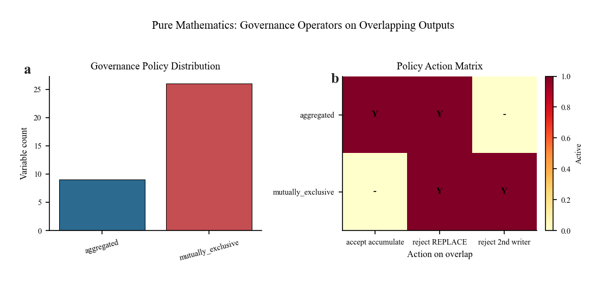
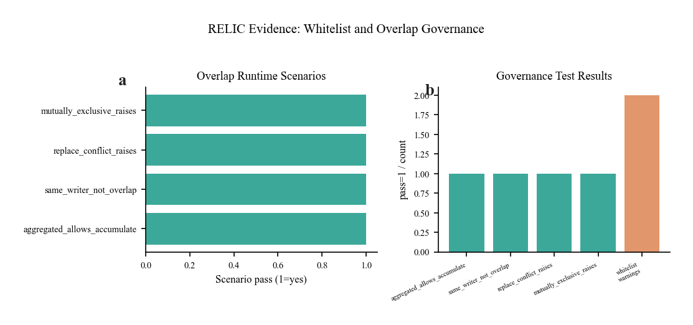

# 教程 21 -- 通量白名单与输出重叠治理

## 1. 概述

本教程调用 RELIC 辅助函数，检查通量白名单警告和输出重叠治理。当前策略为 aggregated（允许兼容的加法写入者）和 mutually_exclusive（拒绝不同写入者）。两种策略都拒绝 REPLACE 冲突；同一写入者再次输出不视为第二写入者。

### 先决条件

- [教程 04](./04_semantic_ssot.md)：变量契约与写入权限
- [教程 11](./11_variable_provenance.md)：写入者追踪

---

## 2. 数学基础

### 2.1 重叠策略代数

| 策略 | 第二个 ACCUMULATE 写入者 | REPLACE 冲突 | 同一写入者 |
| ------------------ | -------------------- | -------------------- | ------------- |
| aggregated | 接受 | 拒绝 | 不构成重叠 |
| mutually_exclusive | 拒绝 | 拒绝 | 不构成重叠 |

### 2.2 通量白名单

新鲜执行捕获 2 条白名单警告：未授权输入和输出各 1 条；授权及零流控制样例为 0 条。四个重叠场景也均通过。此结果验证这些脚本样例，不代表任意配置的全局授权证明。

对于每个守恒的状态变量 $v$，一个白名单 $\mathcal{W}_v = (\mathcal{W}_v^{\text{in}}, \mathcal{W}_v^{\text{out}})$ 指定了哪些函子被允许增加或减少 $v$：

$$
\text{如果 } \Delta v_F > 0: \quad F \in \mathcal{W}_v^{\text{in}} \\
\text{如果 } \Delta v_F < 0: \quad F \in \mathcal{W}_v^{\text{out}}
$$

违规将触发警告（在当前运行中非致命），由 `relic\\core\\simulator\\execution_group.py` 中的 `_check_flux_whitelist()` 发出。

> **参考文献**：spatiotemporal_scale_topology.md，第 8.3-8.4 节

---

## 3-5. 计算、RELIC 映射与图表

针对 `_resolve_overlap_and_maybe_skip` 测试了四种场景：

- **A**：aggregated 允许累积 -- PASS
- **B**：同一写入者不构成重叠 -- 预期通过
- **C**：REPLACE 冲突抛出 RuntimeError -- 预期通过
- **D**：mutually_exclusive 引发 RuntimeError -- PASS

### 图 1：治理策略 (`21_math_governance_policies.png`)



**图 (a)：策略分布** -- 每种策略类型的变量计数条形图。

**图 (b)：策略行动矩阵** -- 2x3 热力图：接受第二个 ACCUMULATE 写入者、拒绝 REPLACE 冲突、拒绝任意第二写入者。

### 图 2：RELIC 治理证据 (`21_relic_governance_evidence.png`)



**图 (a)：重叠运行时场景** -- 每个场景的水平通过/失败条形图。

**图 (b)：治理测试结果** -- 场景结果和白名单警告计数的组合条形图。

---

## 6-9. 比较、控制台输出、关联与参考文献

**新鲜执行输出（2026-09-30）：**

```text
Loaded policies: 35
Policy counts: {'aggregated': 9, 'mutually_exclusive': 26}
Overlap outcomes: {'aggregated_allows_accumulate': 'pass', 'same_writer_not_overlap': 'pass', 'replace_conflict_raises': 'pass', 'mutually_exclusive_raises': 'pass'}
Flux whitelist warning counts: {'warning_count': 2, 'input_warning_count': 1, 'output_warning_count': 1, 'control_warning_count': 0}
```

**关联**：教程 04 (SSOT)，教程 19（连接验证器） | **参考文献**：spatiotemporal_scale_topology.md 第 8.3-8.4 节
