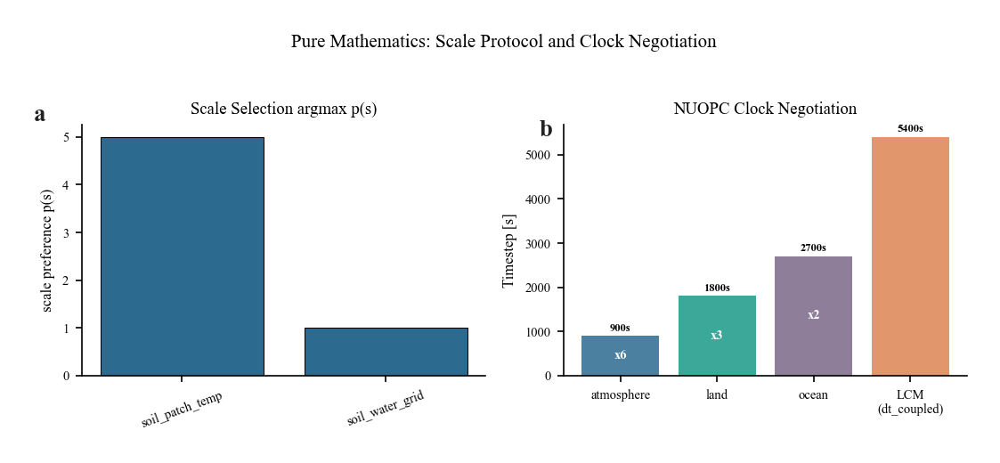
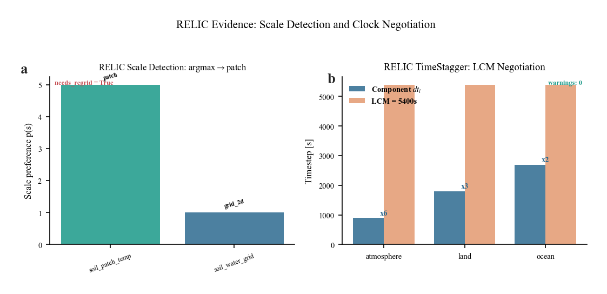

# 教程 22 -- 尺度一致性、NUOPC 时钟协商与能力注册表

## 1. 概述

本教程填补了 `spatiotemporal_scale_topology.md` 中的几个协议/治理空白：**元数据优先的尺度一致性检测**（第 9.2 节）、**函子摘要内省**（第 10.2 节）、通过可公度步长的 LCM 进行的**兼容 NUOPC 的时钟协商**（第 11.1 节），以及**能力注册表**（第 11.2 节）。

### 先决条件

- [教程 15](./15_scale_coupling.md)：SpatialScale 标签和已声明聚合
- [教程 07](./07_multirate_execution.md)：时间尺度 (TemporalScale) 分组

---

## 2. 数学基础

### 2.1 尺度一致性

$$
s^* = \arg\max_{s \in U} p(s) \tag{1}
$$

其中 $U$ 是在当前状态中检测到的唯一空间尺度的集合。

只要被检查的输出中有任一声明了元数据尺度（第 1 层级），就只比较已声明的输出；名称/形状启发式（第 2 层级）仅在无任何声明时使用。结果只是标签比较，实际重网格还需要显式的源、目标网格描述符。

### 2.2 NUOPC 时钟协商

$$
\Delta t_{\text{coupled}} = \mathrm{lcm}(\Delta t_1, \Delta t_2, \ldots, \Delta t_n) \tag{2}
$$

公式 (2) 仅适用于可公度、为 1 ms 整数倍且共享时间原点的步长；实现把每个步长截断为整数毫秒、忽略 `start_time`，也无法表示日历周期，因此任意浮点步长可能得到错误的 LCM（1/3 s 与 1 s 得到 333 s）。`TimeStagger` 只用于外部耦合。

子循环比率（LCM 模式）：$r_i = \Delta t_{\text{coupled}} / \Delta t_i$（每个耦合步数的组件步数）。

> **参考文献**：spatiotemporal_scale_topology.md，第 9.2、10.2、11.1-11.2 节

---

## 3-5. 计算、RELIC 映射与图表

- 尺度检测：PATCH 与 GRID_2D 均来自元数据声明；由于存在声明输出，未声明的 `aux_scalar` 被忽略；目标标签为 PATCH
- 时钟协商：大气 (atm)=900s，陆地 (land)=1800s，海洋 (ocean)=2700s $\Rightarrow$ LCM=5400s

### 图 1：尺度协议与时钟协商 (`22_math_scale_nuopc.png`)



**图 (a)：尺度选择** -- 每个检测变量基于偏好值的条形图。最高偏好值决定目标尺度。

**图 (b)：NUOPC 时钟协商** -- 各组件时间步长的条形图与 LCM 结果。标注了子循环比率（LCM 模式：每个耦合步数的组件步数）。

### 图 2：RELIC 证据 (`22_relic_scale_nuopc_capability.png`)



**图 (a)：RELIC 尺度检测** -- 优先通过元数据进行 $\arg\max\to$ 目标尺度 (`target_scale`) 判定。显示了 `needs_regrid` 标志。

**图 (b)：RELIC 时间交错 LCM** -- 分组条形图：组件 $\Delta t_i$ 与 协商后的 LCM 的对比。标注了子循环比率（LCM 模式）。

---

## 6-9. 比较、控制台输出、关联与参考文献

**控制台（观察结果）**：

```text
=== Tutorial 22: Scale consistency, NUOPC, capability registry ===
  Scale check needs_regrid: True
  Detected scales: {'soil_patch_temp': 'patch', 'soil_water_grid': 'grid_2d'}
  Target scale: patch
  NUOPC negotiated dt: 5400.0 s
  NUOPC subcycle ratios: {'atmosphere': 6, 'land': 3, 'ocean': 2}
  Capability counts: implemented=10, partial=0, not_implemented=1
  Functor summary keys: ['FastHydro', 'SlowBiogeochem']
```

**关联**：教程 07（时间组），教程 15（空间尺度） | **参考文献**：spatiotemporal_scale_topology.md 第 9.2、10.2、11.1-11.2 节
