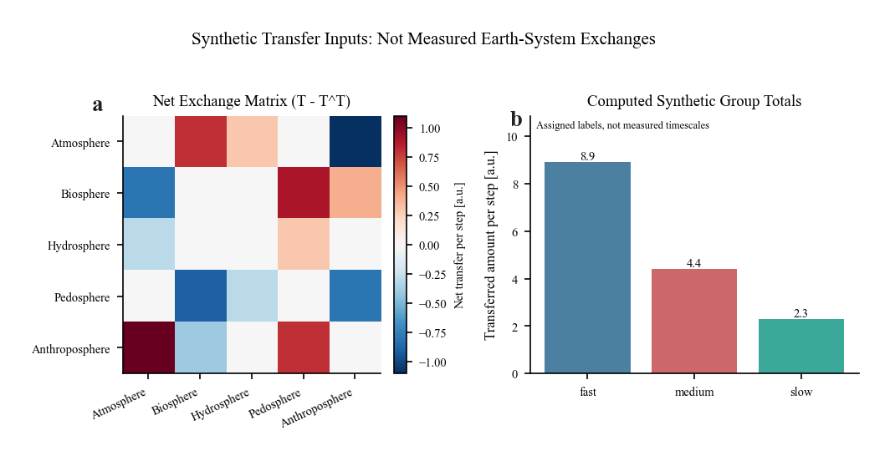
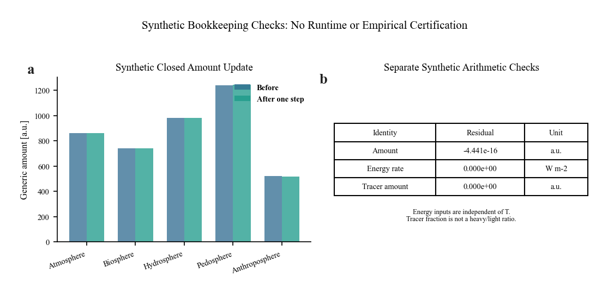

# 教程 23 -- 统一的五圈层交换：能量与同位素守恒

## 1. 概述

本独立 NumPy 教程使用五圈层标签和一个合成 $5 \times 5$ 转移量矩阵，检查内部转移抵消、独立的预设地表能量算术示例和合成示踪库存。它不执行 RELIC 科学 Functor，也不验证物理多物种或 $\delta^{13}C$ 预算。

### 先决条件

- [教程 01](./01_incidence_matrix_conservation.md)：守恒定理
- [教程 06](./06_conservation_ledger.md)：预算残差

---

## 2. 数学基础

### 2.1 定向转移矩阵（每步转移量）

令五个圈层的索引为
$i\in\{0,1,2,3,4\}=\{\text{大气 (Atm)},\text{生物 (Bio)},\text{水 (Hydro)},\text{土壤 (Pedo)},\text{人类 (Anthro)}\}$。
令 $\mathbf{S}\in\mathbb{R}^5$ 为圈层储量向量。

定义**定向转移矩阵** $\mathbf{T}\in\mathbb{R}_{\ge 0}^{5\times 5}$，其中 $T_{ij}$ 是一步内从圈层 $i\to j$ 转移的量（对角线为 0），与 $S_i$ 采用相同的合成储量基准。此处外部 $F_i^{\text{ext}}$ 同样表示每步量，不是变化率。
那么储量增量为：

$$
\Delta S_i
= \Big(\sum_{j} T_{j i} - \sum_{j} T_{i j} + F_i^{\text{ext}}\Big),
\qquad i=0,\dots,4. \tag{1}
$$

向量形式（此处 $\mathbf{1}$ 为全一向量）：

$$
\Delta \mathbf{S} = \big(\mathbf{T}^\top\mathbf{1} - \mathbf{T}\mathbf{1} + \mathbf{F}_{\text{ext}}\big). \tag{2}
$$

对于一个**闭合的内部转移网络** ($\mathbf{F}_{\text{ext}}=\mathbf{0}$),

$$
\mathbf{1}^\top \Delta\mathbf{S} = 0. \tag{3}
$$

为了可视化，我们还定义了反对称的**净交换矩阵** $\mathbf{N}:=\mathbf{T}-\mathbf{T}^\top$，其中 $N_{ij}>0$ 代表对于这一对圈层，从 $i\to j$ 的净交换主导了 $j\to i$ 的净交换量。

### 2.2 能量闭合（地表能量平衡）

我们使用标准的闭合诊断式：

$$
r_E = R_{\text{net}} - \big(H + LE + G + \Delta S_{\text{canopy}}\big), \tag{4}
$$

公式 (4) 的各项均为 W m$^{-2}$ 变化率，包括脚本变量 $\Delta S_{\text{canopy}}$；该标签表示冠层储能率，不是能量增量。预设数值满足 $525=130+330+40+25$。这一独立算术示例并非由转移矩阵推得。

### 2.3 内部转移下的同位素闭合

将 $R_i$ 解释为合成示踪组分比例，定义示踪储量 $M_i^{13} := S_i R_i$，上标仅作示意。若 $R_i$ 是重/轻同位素比且 $S_i$ 是总同位素量，精确重同位素库存应为 $S_iR_i/(1+R_i)$。对于乘子为 $\alpha_{ij}$ 的合成转移 $i\to j$，每步示踪转移量为：

$$
F^{13}_{i\to j} = T_{ij}\,R_i\,\alpha_{ij}. \tag{5}
$$

更新法则：

$$
M_i^{13,\text{new}} = M_i^{13,\text{old}} - \sum_j F^{13}_{i\to j} + \sum_j F^{13}_{j\to i}. \tag{6}
$$

闭合网络示踪残差（供体减量与受体增量相同，因此代数抵消；仅凭这一点不验证同位素分馏物理）：

$$
r_{13} = \sum_i M_i^{13,\text{new}} - \sum_i M_i^{13,\text{old}}. \tag{7}
$$

---

## 3. 计算细节（本教程的数据）

- 圈层：大气圈、生物圈、水圈、土壤圈、人类圈
- $\mathbf{T}$：同一任意储量基准上的合成每步转移量；碳、水和养分标签不允许把不同物理量相加。
- $\mathbf{S}(t)$：合成储量基线，由公式 (1) 更新
- 诊断：
  - 质量闭合残差：$\sum_i \Delta S_i$
  - 能量闭合残差：来自公式 (4) 的 $r_E$
  - 同位素闭合残差：来自公式 (7) 的 $r_{13}$
  - 耦合强度：将 $\mathbf{T}$ 中选定的条目按快/中/慢边组求和

---

## 4. 图表与输出

### 4.1 图 1：数学框架 (`23_math_five_sphere_matrix.png`)



**图 (a)：净交换矩阵 $\mathbf{N}=\mathbf{T}-\mathbf{T}^\top$**

- 跨五个圈层的热力图
- 正值（红色）表示主导方向为从行圈层到列圈层的净交换
- 负值（蓝色）表示主导方向相反
- 通过构造，对角线处为 0（成对净交换）

**图 (b)：示例范围**

- 本图使用合成矩阵实际求和得到快/中/慢边组每步转移量 8.9/4.4/2.3 a.u.；组名是指定标签，不是推断时间尺度。

### 4.2 图 2：合成闭合诊断 (`23_relic_five_sphere_conservation.png`)



**图 (a)：储量更新 $\mathbf{S}(t)\to \mathbf{S}(t+\Delta t)$**

- 每个圈层在应用公式 (1) 之前和之后的储量条形图
- 说明包含了快/中/慢边组的聚合耦合强度

**图 (b)：闭合诊断**

- 表格分别列出转移量残差（a.u.）、独立预设能量恒等式残差（W m-2）和示踪残差（a.u.），不同单位不共用数值轴。
- 对于一个闭合内部转移演示而言，所有的残差应接近浮点数舍入误差

---

## 5. 控制台输出解释

```text
=== Tutorial 23: Synthetic amount/tracer arithmetic, not runtime validation ===
  Synthetic amount residual [a.u.] (sum dS): -4.441e-16
  Independent prescribed energy identity residual: 0.000e+00 W m-2
  Synthetic tracer residual [a.u.]: 0.000e+00
  Assigned edge-group totals [a.u. per step]: {'fast': 8.9, 'medium': 4.4, 'slow': 2.3}
```

---

## 6. 参考文献

1. `docs\source\theory\00_unified_theoretical_framework.md`，第 2.1-2.3 和 5.2-5.3 节
2. `coertheory.md`，第 2.2 和 3.3 节（结构守恒与预算残差框架）
3. Bonan (2019)，_Climate Change and Terrestrial Ecosystem Modeling_
