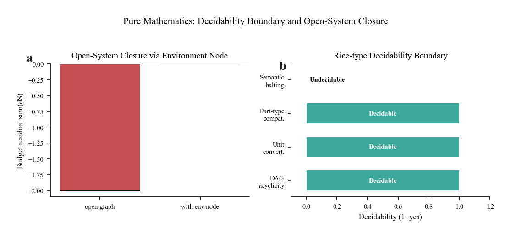
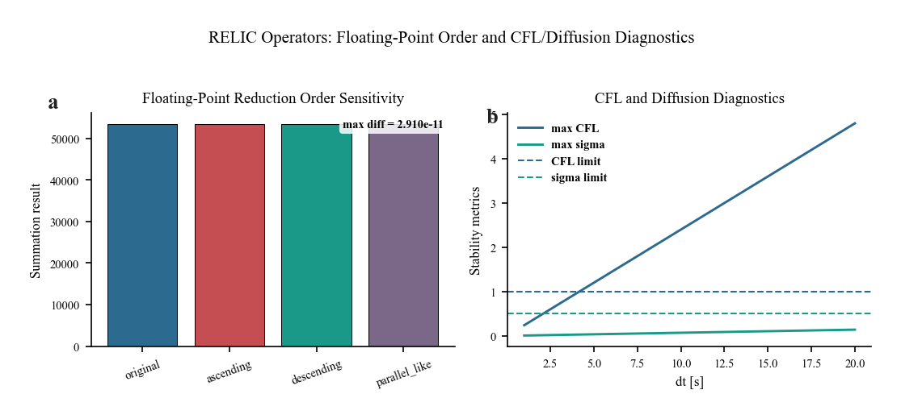

# 教程 24 -- 判断性边界、浮点运算、CFL 诊断与开放系统闭合

## 1. 概述

本教程填补了 `coertheory.md` 中的四个余留空白点：(1) **浮点数非结合律**（第 1.3 节），展示了求和顺序的敏感性；(2) **Rice 类型可判定性边界**（第 1.4 节），分类哪些属性是算法可检查的；(3) **CFL 与扩散稳定性诊断**（第 3.4 节）：脚本统计哪些 $\Delta t$ 满足 $\text{CFL} \le 1$ 且 $\sigma \le 0.5$；RELIC 的自适应步长控制器不施加这些限制，门控须由调用过程自行实现；以及 (4) **开放系统闭合**（第 2.5.6 节），通过添加环境节点来实现。

### 先决条件

- [教程 09](./09_adaptive_timestep.md)：自适应时间步长
- [教程 01](./01_incidence_matrix_conservation.md)：关联矩阵

---

## 2. 数学基础

### 2.1 浮点数非结合律

$\text{fl}(\sum x_i)$ 取决于规约顺序——由于有限精度的影响，不同的运算排序将得出不同的结果。

### 2.2 CFL 与扩散稳定性

$$
\text{CFL} = \frac{|v| \Delta t}{\Delta x} \le 1, \quad \sigma = \frac{D \Delta t}{\Delta x^2} \le 0.5 \tag{1}
$$

这些阈值限于所示一维均匀网格显式格式：一阶迎风平流取 $\text{CFL}_{max}=1.0$，中心差分加前向 Euler 扩散取 $S_{max}=0.5$。它们不是任意多维、耦合或高阶格式的充分稳定条件。扩散数为 $\sigma=D\Delta t/\Delta x^2$。

### 2.3 开放系统闭合

令 $\mathbf{B}$ 为关联矩阵（coertheory.md：$\dot{u}=\mathbf{B}f(u)$）。一个开放系统可以由一个图来表示，在该图中存在离开节点的边界通量但却没有接收端点，因此 $\mathbf{B}$ 的某一列仅包含一个单一的 $-1$ 元素。由于这打破了 $\mathbf{B}^\top\mathbf{1}=0$ 这一封闭系统恒等式，它会在内部节点集合上产生一个非零的总趋势 $\mathbf{1}^\top \dot{u}$。

只有在相同单位、支撑和时间基准上把每笔边界量实际记入环境节点，扩展代数才闭合：$\mathbf{B}_{ext}^\top\mathbf{1}=0$。内部子系统仍是开放的；标签、端口或诊断残差本身不证明物理闭合。

### 2.4 判断性边界 (可判定性)

| 属性           | 是否可判定？ | 方法      |
| -------------- | ------------ | --------- |
| DAG 无环性     | 是           | Kahn 算法 |
| 单位可转换性   | 是           | 单位代数  |
| 端口类型兼容性 | 是           | 模式匹配  |
| 总体语义正确性 | 否           | Rice 定理 |

> **参考文献**：coertheory.md，第 1.3、1.4、2.5.6、3.4 节；Higham (2002)；Rice (1953)

---

## 3-5. 计算、RELIC 映射与图表

### 图 1：数学：判断性边界与开放系统 (`24_math_decidability_open_system.png`)



**图 (a)：开放系统闭合** -- 条形图：开放图残差判定 $\ne 0$；加入环境节点后残差 $= 0$。

**图 (b)：判断性边界** -- 水平条形图：可判定的属性值为 1。具有不可判定性的“语义停机”属性，绘制于值 0，并附带明确说明文本（Rice 类型边界）。

### 图 2：RELIC 数值计算与 CFL (`24_relic_numerics_cfl.png`)



**图 (a)：FP 降维求和排序敏度** -- 不同排序（原始/升序/降序/并行）下的求和结果条形图。显示了最大偏差。

**图 (b)：CFL 与扩散诊断** -- 由 `compute_cfl_number` 与 `compute_diffusion_stability` 计算的、不同 $\Delta t$ 值对应的最大 CFL 与最大 $\sigma$ 的线形图。1.0 与 0.5 处的阈值线标注脚本采用的显式格式稳定性极限；RELIC 步长控制器不施加这些限制。

---

## 6-9. 比较、控制台输出、关联与参考文献

**控制台（观察结果）**：

```text
=== Tutorial 24: Decidability and numerical stability boundaries ===
  Open-system residual before closure: -2.000000
  Residual after adding environment node: 0.000000
  Floating-point max order difference: 2.910383e-11
  Stable dt count (CFL<=1 and sigma<=0.5): 7/40
```

**参考文献**：Higham (2002)；Rice (1953)；coertheory.md
