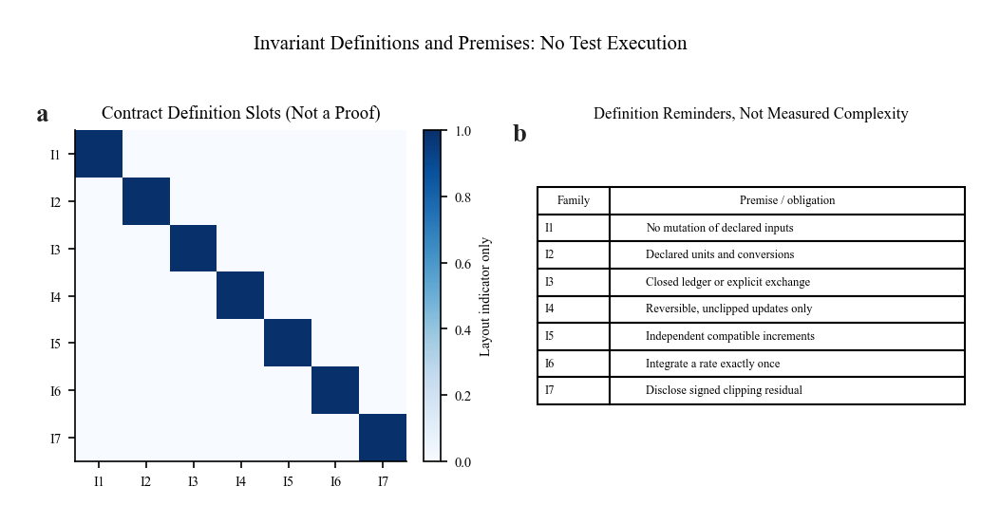
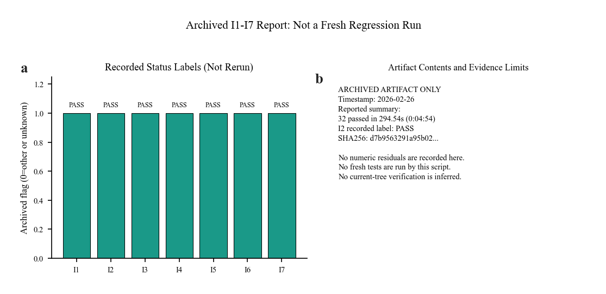

# 教程 25 -- 不变性契约 I1-I7

## 1. 概述

本教程演示了 RELIC 的七大**不变性契约** (I1-I7)，以及在实践中是如何对它们进行验证的（spatiotemporal_scale_topology.md 第 8.2 节；00_unified_theoretical_framework.md 第 5.4 节）。

它生成两个交付成果：

1. **定义视图**（图 1）：不变量示意矩阵和各契约的适用前提/义务表，不作验证复杂度评分。
2. **经验测试回归视图**（图 2）：加载 `test\invariants\invariant_report.json`（由 `python -m test.invariants.generate_report` 生成），可视化既有 PASS/UNKNOWN 状态；它不执行这些测试。

### 为什么它很重要

轨迹一致性本身并不足够。这些契约给出针对已声明范围和测试样例的可检查要求；有限回归套件不证明所有 Functor、配置和时间步都满足要求。既有报告只为其中记录的那次运行提供证据。

### 先决条件

- 先前所有的教程环节（I1-I7 概括了整个结构上的、语义上的以及数值形式的计算框架）

---

## 2. 数学基础

令 $\mathcal{X}$ 表示该模拟器状态（即一个 `StateManager` 快照），并令 $\delta$ 表示在时间步长 $\Delta t$ 内由一个或多个函子生成的状态增量（提案）。我们将事务型提交操作定义为 $\mathcal{U}_{\Delta t}$（coertheory.md 定理 3.6.6），其能将增量做统一聚合操作、约束条件校验，继而实施原子化的**提交或回滚 (commits-or-rolls-back)**。

### 2.1 契约目录 (spatiotemporal_scale_topology.md，第 8.2 节)

**I1 -- 无副作用 (No Side Effects)。** 一个函子的 `forward()` 方法决不允许篡改它的输入状态：

$$
\mathcal{X}_{\text{before}} = \mathcal{X}_{\text{after\_forward}}.
$$

含义：forward 不得修改输入 StateManager 状态。这比数学纯函数的要求窄；受治理的 Functor extra state 和受支持的随机数通道仍可演化。

**I2 -- 单位一致性 (Unit Consistency)。** 针对 `ACCUMULATE` 模式，生成的增量单位必须匹配目标变量的单位：

$$
[\Delta x_v] = [x_v].
$$

含义: 量纲分析通过 SSOT 目录/契约层得到强制执行。

**I3 -- 守恒性（预算残差）(Conservation (Budget Residual))。** 对任意带声明信源 $S_j$ 和汇聚信点 $L_k$ 的守恒量 $Q(t)=\sum_{i=1}^{n} w_i x_i(t)$ ，每步的预算残差都有边界约束：

$$
r_Q
=
\left| \sum_{i=1}^{n} w_i \Delta x_i - \left(\sum_j S_j - \sum_k L_k\right)\Delta t \right|
\le \epsilon_{\text{conservation}}.
$$

特殊情况（闭合的内部交换网络）: $(\sum_j S_j-\sum_k L_k)=0$, 所以 $r_Q = \left|\sum_i w_i \Delta x_i\right|$。

**I4 -- 可逆性 (Reversibility)。** 应用 $+\delta$ 之后再应用 $-\delta$ ，能够（在浮点数舍入误差范围内）恢复初始状态：

$$
\mathcal{U}_{\Delta t}(-\delta,\ \mathcal{U}_{\Delta t}(+\delta,\ \mathcal{X}))
=
\mathcal{X} + \mathcal{O}(\epsilon_{\text{machine}}).
$$

含义：此加法逆操作检查要求授权和验证成功、没有实际截断、没有穿插依赖状态的计算；它不声称物理过程时间可逆。

**I5 -- 交换律（加法累加）(Commutativity (Additive Updates))。** 独立的增量具有顺序不变性：

$$
\mathcal{U}_{\Delta t}(\delta_b,\ \mathcal{U}_{\Delta t}(\delta_a,\ \mathcal{X}))
=
\mathcal{U}_{\Delta t}(\delta_a,\ \mathcal{U}_{\Delta t}(\delta_b,\ \mathcal{X})).
$$

含义：固定且独立的 ACCUMULATE 增量在两种次序都不触发投影或依赖状态的验证时满足精确算术交换律。浮点比较需要容差；顺序执行的非线性 Functor 不必可交换。

**I6 -- dt-准度法则 (dt-Scaling)。** 针对基于 `per_second` （每秒）基准算出的递增项，按比例缩放时间步长会使得增量项呈线性比例缩放：

$$
\Delta x(\alpha\Delta t) = \alpha\,\Delta x(\Delta t) + \mathcal{O}(\Delta t^2).
$$

含义：检查时间基准换算时固定变化率、单位和支撑；这不声称不同步长下的非线性轨迹相同。

**I7 -- 边界截断限幅 (Bounds Clipping)。** 当应用边界投影操作时，将产生一条名为 `clip_loss` 的诊断信息：

$$
x^{n+1} = \text{clamp}(x^n + \delta,\ L,\ U),
\qquad
\text{clip\_loss} = x^{\text{unclamped}} - x^{n+1}.
$$

含义：clip_loss 带符号；正值表示上界移除提议储量，负值表示下界补入储量。它披露修正量，本身不为物理预算提供外部路由或闭合。

---

## 3. 计算细节

### 3.1 报告事实基准

测试得出的经验证据来源于：

- 报告路径：`test\invariants\invariant_report.json`
- 生成指令：`python -m test.invariants.generate_report`

该报告涵盖内容：

- `timestamp`: UTC 运行时间戳
- `summary`: pytest 结果摘要摘要
- `invariants`: 包含 I1-I7 项在 PASS（通过）/UNKNOWN（未知）方面的总结记录
- 捕捉到的 `stdout`/`stderr` 内容

### 3.2 图形生成逻辑

绘图脚本 `tutorial\theory\25_invariant_contracts_i1_i7.py`:

1. 加载 JSON 数据报告（如果没有它则用一个表明缺失存留特征的“插桩”条目替换）。
2. 将属 I1-I7 项目的 PASS 或 UNKNOWN 状态解析为表示成功通过标志 (1/0) 体系。
3. 产生:
   - 图 1：契约定义与适用前提。
   - 图 2：既有标签与实际报告元数据；不执行测试。

注意：报告没有逐不变量数值残差。当前图 2b 直接显示档案时间戳、摘要、I2 原始标签与 SHA256，明确不验证当前代码；旧固定残差和固定 MATCH 注记已移除。0 标志可表示 UNKNOWN，不等于 FAIL。

---

## 4. RELIC 映射实现

不变性测试套件存放在 `test\invariants\` 目录下 (带有 `.test.py` 后缀识别名的 Python 代码):

- I1: `side_effects.test.py`
- I2: `units.test.py`
- I3: `conservation.test.py`, `mass_energy_balance.test.py`
- I4: `reversibility.test.py`
- I5: `commutativity.test.py`
- I6: `dt_scaling.test.py`, `test_update_modes.py`
- I7: `bounds_clipping.test.py`

---

## 5. 图标与输出

### 5.1 图 1：纯数学验证模式 (`25_math_invariants_i1_i7.png`)



**图 (a)：不变性基础 I1-I7**

- 类单位矩阵的图示：这属于概念表达范式，展示了把每一款约束条文作为一条相互独立界域验证轴线来处理的特点。

**图 (b)：适用前提与义务** -- 七行定义表说明输入状态不变、单位、账本域、无截断加法逆、独立增量、固定变化率时间换算及带符号截断诊断；不显示实测复杂度。

### 5.2 图 2：RELIC 回归状态 (`25_relic_invariants_i1_i7.png`)



**图 (a)：不变性测试结果**

- 对于 I1-I7 项获得判定状态 PASS (1=PASS)，衍生自 `invariant_report.json`。

**图 (b)：归档报告字段** -- 显示 2026-02-26 时间戳、32 passed 的历史摘要、I2 归档 PASS 及真实文件 SHA256；不计算残差、不执行测试、不认证当前仓库。

---

## 6. 数学模型-RELIC 系统之对比情况陈述与一览表单

| 不变量 | 数学公式判断谓词 (见第 2.1 节)                                      | 证据来源出处              | 预期结果 |
| ------ | ------------------------------------------------------------------- | ------------------------- | -------- |
| I1     | $\mathcal{X}_{\text{before}}=\mathcal{X}_{\text{after\_forward}}$   | `side_effects.test.py`    | PASS     |
| I2     | $[\Delta x_v]=[x_v]$                                                | `units.test.py`           | PASS     |
| I3     | $r_Q \le \epsilon_{\text{conservation}}$                            | `conservation.test.py`    | PASS     |
| I4     | $\mathcal{U}(-\delta,\mathcal{U}(+\delta,\mathcal{X}))=\mathcal{X}$ | `reversibility.test.py`   | PASS     |
| I5     | 顺序不变性的累加式提交执行                                          | `commutativity.test.py`   | PASS     |
| I6     | $\Delta x(\alpha\Delta t)\approx \alpha\Delta x(\Delta t)$          | `dt_scaling.test.py`      | PASS     |
| I7     | 实现边界裁剪必须产生 `clip_loss` 发出警报信息                       | `bounds_clipping.test.py` | PASS     |

---

## 7. 控制台输出机制说明解释及含义体示

本轮重新读取归档报告的输出；历史测试没有重新执行：

```text
=== Tutorial 25: Invariant definitions and archived labels; no tests run ===
  Archived report timestamp: 2026-02-26T12:58:47.652931+00:00
  Archived report summary: ======================= 32 passed in 294.54s (0:04:54) ========================
  Archived labels encoded for display (not new test results): [1.0, 1.0, 1.0, 1.0, 1.0, 1.0, 1.0]
```

---

## 8. 与其它教程之间的关联

| 不变量 | 相关教程                                 |
| ------ | ---------------------------------------- |
| I1     | 教程 05（事务处理更新与状态回滚）        |
| I3     | 教程 01 与 教程 06（关联守恒与预算残差） |
| I5     | 教程 12（拆分敏感性诊断）                |
| I6     | 教程 09（自适应步进使用误差范数与重试）  |
| I7     | 教程 10（边界投影与 clip-loss）          |

---

## 9. 参考文献

1. `docs\source\theory\spatiotemporal_scale_topology.md`，第 8.2 节
2. `docs\source\theory\00_unified_theoretical_framework.md`，第 5.4 节
3. coertheory.md，定理 3.6.3 和 3.6.6（投影与事务语义）
4. `test\invariants\*.test.py`
